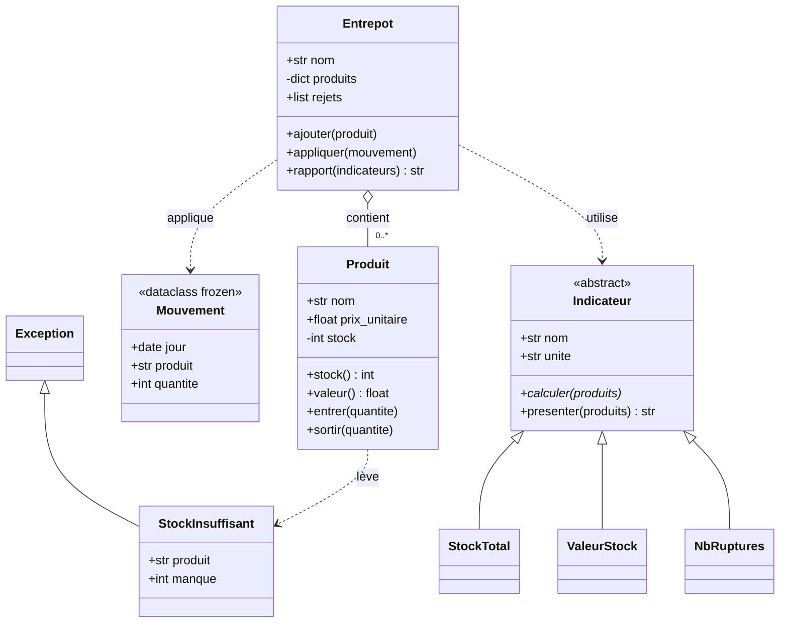

# Diagramme de classes — exemple « suivi de stock »

Structure du module `suivi_stock_exemple.py`. À reproduire, avec vos propres classes, dans `diagramme_objectifs.md`.

Lecture :

- **Héritage** (`<|--`) : les trois indicateurs concrets **sont des** `Indicateur` ; `StockInsuffisant` **est une** `Exception`.
- **Agrégation** (`o--`) : l'entrepôt **contient** des produits créés à l'extérieur et ajoutés un par un.
- **Dépendance** (`..>`) : l'entrepôt **utilise** des mouvements et des indicateurs sans les posséder.
- `-int stock` est **privé** : on le lit par la propriété `stock()` et on le modifie seulement par `entrer` / `sortir`, qui valident.
- `calculer(produits)*` : l'astérisque marque la méthode **abstraite**, que chaque fille doit implémenter.
