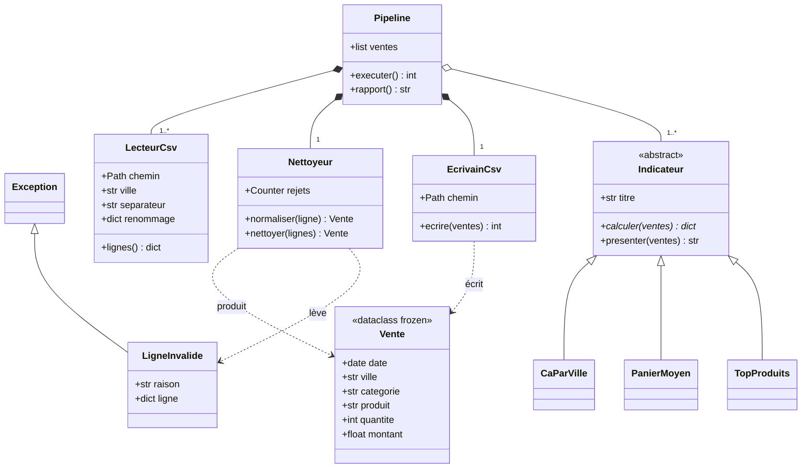

# Diagramme de classes — exemple « consolidation Tourcoing + Lille »

Structure du module `consolidation_exemple.py`. À reproduire, avec vos propres classes, dans votre `RAPPORT.md`.

Lecture :

- `Pipeline` **compose** (`*--`) ses lecteurs, son nettoyeur et son écrivain : ils sont construits pour lui et n'ont pas de sens sans lui.
- Les indicateurs sont **agrégés** (`o--`) : on peut en passer une liste différente à chaque exécution.
- `LecteurCsv` ne connaît que **son** fichier : séparateur et renommage sont des paramètres, pas du code dupliqué.
- Toute la logique de conformité est dans `Nettoyeur` ; une ligne refusée est une **exception** `LigneInvalide` porteuse de sa raison, comptée dans `rejets`.
