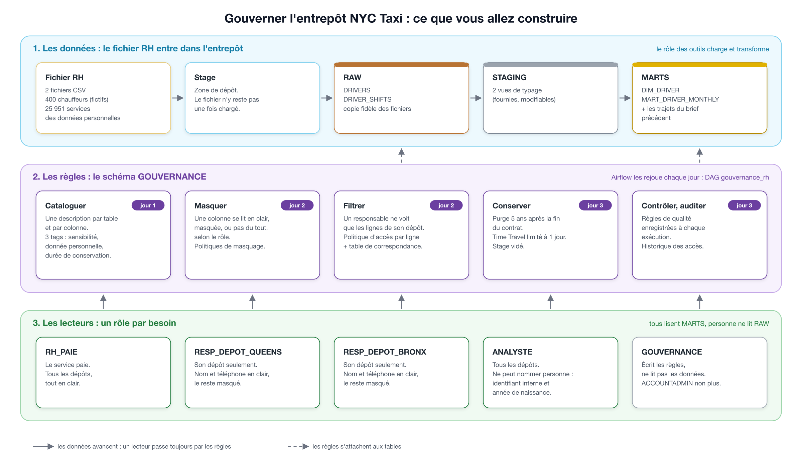

# Kit de démarrage — Gouverner l'entrepôt NYC Taxi (catalogue, accès, conservation)

Ce kit s'ajoute à votre projet du brief précédent : il ne le remplace pas.

## Dans quel ordre lire

1. **Le brief** : la situation, ce qui est attendu, comment vous serez évalués.
2. **Ce fichier** (`README_GOUVERNANCE.md`) : ce que contient le kit et comment l'ajouter à votre projet.
3. **`CONTRAT_GOUVERNANCE.md`** : les noms imposés, la matrice des accès, les durées de conservation, les règles de qualité. C'est le document de référence des trois jours.
4. **`ETAPES_GOUVERNANCE.md`**, chaque matin : le détail de la journée, les pièges, le résultat à obtenir.

## Ce que vous allez construire



## Ajouter le kit à votre projet

Copiez le contenu du kit à la racine de votre dépôt `nyc-taxi-pipeline` (commandes dans les ressources) : les dossiers `airflow/`, `snowflake/` et `docs/` se complètent, et aucun de vos fichiers n'est écrasé.

```
.
├── README_GOUVERNANCE.md                  ce fichier
├── CONTRAT_GOUVERNANCE.md                 ce qui est imposé
├── ETAPES_GOUVERNANCE.md                  le détail de chaque journée
├── data/
│   ├── drivers.csv                        FOURNI : 400 chauffeurs (personnes fictives)
│   └── driver_shifts.csv                  FOURNI : les services de janvier à mars 2025
├── snowflake/gouvernance/
│   └── modele_catalogue_dim_zone.sql      FOURNI : la fiche de catalogue d'une table, comme modèle
├── docs/
│   ├── gouvernance.png                    le schéma
│   ├── INVENTAIRE_MODELE.md               modèle d'inventaire des données personnelles (jour 1)
│   ├── MATRICE_TESTS_MODELE.md            modèle de cahier de tests des accès (jour 2)
│   └── REGISTRE_MODELE.md                 modèle de fiche de registre des traitements (jour 3)
└── airflow/include/sql/rh/                FOURNI : les fichiers SQL du domaine RH, modifiables
    ├── 00_tables_rh.sql                   crée DIM_DRIVER et MART_DRIVER_MONTHLY
    ├── staging/                           2 vues de typage
    ├── marts/                             la dimension chauffeur et l'activité mensuelle
    └── controles/licence_unique.sql       1 règle de qualité fournie comme modèle
```

## Prérequis

- Le compte Snowflake du brief précédent, en édition **Enterprise** : le masquage, le filtrage des lignes, les tags et l'historique des accès n'existent pas en édition Standard. Vérifiez avec `SELECT CURRENT_VERSION(), CURRENT_ACCOUNT();` et, dans Snowsight, le menu du compte.
- La base `NYC_TAXI`, ses schémas, votre rôle des outils, votre utilisateur de service et votre projet Airflow en état de marche.
- Si votre compte d'essai a expiré : recréez-en un et rejouez vos scripts du brief précédent. C'est le moment de vérifier qu'ils sont rejouables.

## Les données fournies

Le fichier RH est fictif : aucun chauffeur n'existe, les adresses e-mail se terminent par `.example` et ne mènent nulle part. Traitez-le pourtant comme un vrai fichier du personnel : c'est le sujet du brief.

| Fichier | Lignes | Contenu |
|---|---|---|
| `data/drivers.csv` | 400 | identité, coordonnées, licence, dépôt, dates d'embauche et de fin de contrat |
| `data/driver_shifts.csv` | 25 951 | un service par ligne : chauffeur, date, dépôt, heures, courses, recette |

Ces fichiers ne se rattachent pas aux trajets de la TLC : les fichiers publics ne disent pas quel chauffeur a fait quelle course. Le lien avec le reste de l'entrepôt passe par la date et le dépôt.

Comme tout fichier venu d'un autre service, celui-ci contient des erreurs. Les règles de qualité du contrat servent à les mesurer.

## Lire les fichiers SQL fournis

- `00_tables_rh.sql` crée les deux tables de `MARTS` si elles n'existent pas. Les deux fichiers de `marts/` les vident et les remplissent (`INSERT OVERWRITE`) sans les recréer.
- Les deux vues de `staging/` sont recréées à chaque exécution (`CREATE OR REPLACE VIEW`).
- Ordre d'exécution : comme au brief précédent, un fichier s'exécute après ceux qui créent ce qu'il lit.
- Ces fichiers ne contiennent aucune accolade : ils ne dépendent pas de la date de l'exécution.

## Résultats attendus

| Mesure | Valeur |
|---|---|
| `RAW.DRIVERS` après chargement | 400 |
| `RAW.DRIVER_SHIFTS` après chargement | 25 951 |
| `STAGING.STG_RH__DRIVER_SHIFTS` | 25 933 |
| `MARTS.DIM_DRIVER` avant la purge | 400 |
| `MARTS.MART_DRIVER_MONTHLY` | 914 |

Les valeurs après la mise en place des politiques et de la purge ne sont pas données : c'est à vous de les prévoir, puis de les mesurer.
